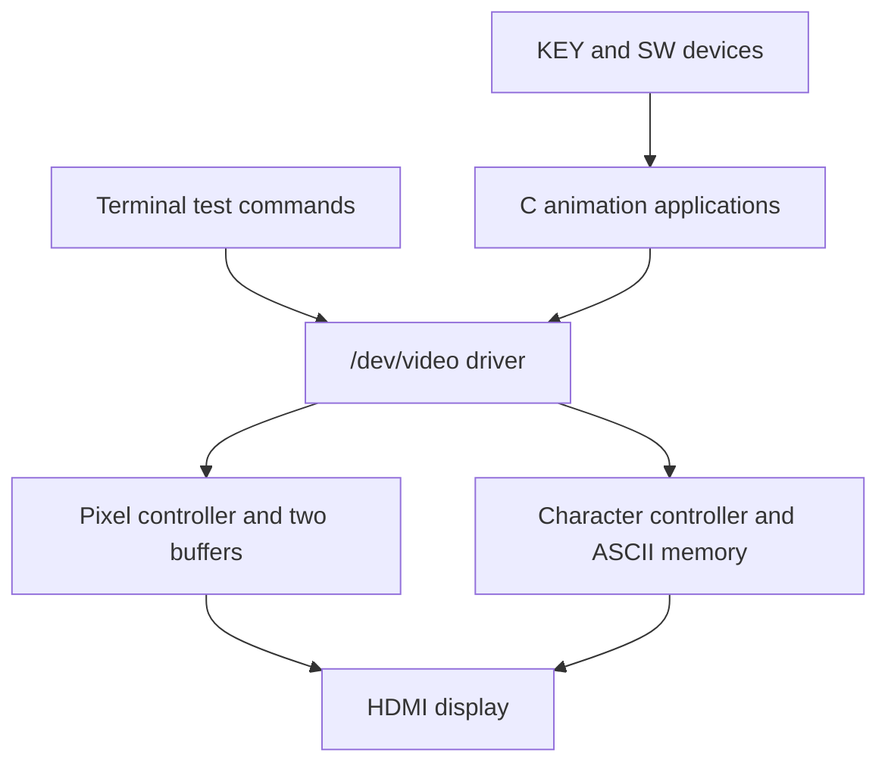

# DE10-Nano Linux Graphics and Animation

A Linux character-device driver and six C applications that turn the DE10-Nano's FPGA video hardware into an interactive graphics display. The project implements pixel plotting, integer line drawing, filled rectangles, refresh synchronization, double buffering, physical button/switch controls, and a text frame counter.

Developed by **Aidan Batt** for ENEE 454 at the University of Maryland.

## Engineering focus

- **Linux kernel development:** character-device registration, file operations, safe userspace copies, mutexes, initialization cleanup, and module lifecycle.
- **Embedded hardware interfaces:** memory-mapped FPGA controllers, byte-accurate pixel addressing, PIO event capture, and RGB565-to-RGB332 conversion.
- **Graphics and timing:** Bresenham's integer algorithm, vertical-blank swaps, front/back buffer management, and bounded diagonal motion.
- **Application design:** signal-based shutdown, hardware controls, monotonic debounce timing, and configurable animation speed and object count.

## Demonstrations

| Program | Demonstration | Buffer mode |
|---|---|---|
| `part1` | Red, green, and blue bars drawn through individual pixel commands | Single |
| `part2` | Horizontal, vertical, diagonal, and reversed-endpoint lines | Single |
| `part3` | Horizontal line bouncing between the top and bottom edges | Single |
| `part4` | Eight filled boxes connected by seven chain links | Double; single-buffer comparison available |
| `part5` | KEY-controlled speed/object count and SW-controlled links | Double |
| `part6` | Interactive animation with a presented-frame text counter | Double |

At the default animation speed, each object moves one pixel per nominal 60 Hz refresh. Higher settings increase displacement per frame; lower settings introduce additional sleep. These are design targets, not benchmark measurements.

## Architecture



The applications decide what to draw. The video driver owns command parsing and FPGA accesses. Pixel commands always draw into the current back buffer, and `sync` presents a completed frame. The independent character layer supplies hardware-generated text glyphs.

## Hardware and software

- Terasic DE10-Nano with the course **DE10-Nano Computer graphics FPGA system** loaded and its HPS-to-FPGA bridges enabled.
- HDMI monitor or TV attached to the board.
- Linux, a C compiler, make, and the configured kernel build tree matching the running kernel.
- Reference build environment: DE10-Nano Linux **3.18.0**, with headers at `/lib/modules/3.18.0/build`.
- `/dev/KEY` and `/dev/SW` providing ASCII hexadecimal inputs, or the optional `key_sw.ko` supplied here.

The driver assumes 320 x 240 stored RGB332 pixels with a 512-byte row stride, and an 80 x 60 character layer. It is specific to that FPGA system; a stock Linux image alone does not provide these peripherals.

## Build

All source files remain in one folder. Compile natively on the board:

```sh
make
```

If the matching kernel tree is elsewhere:

```sh
make KDIR=/absolute/path/to/matching/configured/kernel
```

`make user` builds just the six user applications. `make module` builds `video.ko` and `key_sw.ko`. Do not use unrelated kernel headers to build a module for the running board.

## Run

Run module commands as root. Stop a running animation with **Ctrl+C** before unloading its driver.

### Parts I-III

When `video` is not already loaded:

```sh
insmod video.ko double_buffer=0
cat /dev/video
./part1
./part2
./part3
```

`cat /dev/video` should print `320 240` once. `part1` and `part2` finish after drawing. `part3` continues until Ctrl+C.

### Parts IV-VI

After stopping Part III:

```sh
rmmod video
insmod video.ko double_buffer=1
./part4
```

Before Parts V-VI, check the input devices:

```sh
ls -l /dev/KEY /dev/SW
```

If **both** devices are absent and no other driver owns their PIO registers:

```sh
insmod key_sw.ko
```

Run one animation at a time, stopping it with Ctrl+C before launching another:

```sh
./part5
./part6
```

| Control | Action |
|---|---|
| KEY0 | Sweep speed upward through eight levels, then downward |
| KEY1 | Sweep visible object count upward to 16, then downward to one |
| All SW off | Show connecting chain links |
| Any SW on | Hide the links and retain the moving boxes |

The default KEY contract is a consumed press-event mask. For an existing driver that returns active-high **pressed-key levels**, use `./part5 --key-level` or `./part6 --key-level`. This option does not invert raw active-low states. Alternate device names can be selected with `KEY_DEVICE` and `SW_DEVICE`.

### Single-buffer comparison

After stopping an animation:

```sh
rmmod video
insmod video.ko double_buffer=0
./part4 --single
```

Compare flicker or tearing with the double-buffer version. `--single` describes the selected mode to the application; the module parameter actually configures the hardware pointers.

## Driver command examples

Colors are **RGB565 hexadecimal** at the interface; the driver converts them to the Nano's RGB332 storage.

```sh
echo clear > /dev/video
echo 'pixel 160,120 FFFF' > /dev/video
echo 'line 0,0 319,239 F800' > /dev/video
echo 'box 20,20 40,40 07E0' > /dev/video
echo sync > /dev/video
echo erase > /dev/video
echo 'text 0,0 DE10-Nano Graphics' > /dev/video
```

In double-buffer mode, pixel graphics become visible after `sync`. Character writes affect the independent text layer directly. Send one complete command per write.

## Documentation and validation

- [Architecture and command protocol](docs/ARCHITECTURE.md)
- [Test procedure and debugging](docs/TESTING.md)
- [Native build output](docs/BUILD_LOG.txt)
- [Full project report with code listings](docs/ENEE454_Midterm_Aidan_Batt_Report.pdf)

All six applications and both kernel modules compiled on the board's Linux 3.18.0 environment. A pixel-size status-field extraction bug found during driver insertion was corrected; the driver then loaded successfully. The testing document describes the visual and control checks and distinguishes nominal timing from measured performance.

## Source layout

| File | Responsibility |
|---|---|
| `video.c` | Shared graphics character device and FPGA access |
| `key_sw.c` | Optional KEY event and SW state character devices |
| `part1.c` ... `part6.c` | Standalone user applications with embedded helper routines |
| `Makefile` | Native application and external-module build rules |
| `docs/` | Design notes, testing instructions, build output, and report |

Compiled binaries and kernel modules are excluded from version control because they must be built for the target board and kernel.

## Course context

The project follows the ENEE 454 graphics and animation laboratory, which draws on Intel FPGA University Program teaching materials. This repository contains the implementation and project documentation; the original assignment PDF and report template are not redistributed. Kernel modules retain their `MODULE_LICENSE("GPL")` declarations.
